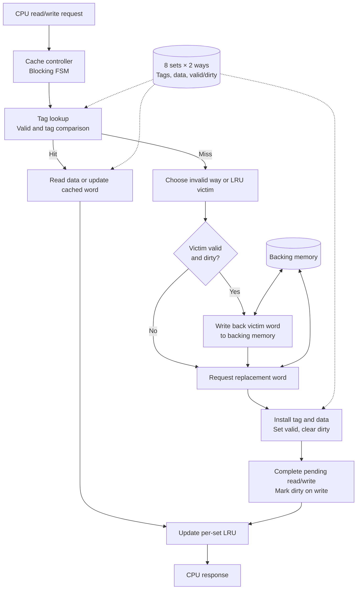

# CacheForge
### SystemVerilog Cache Controller · Cocotb Verification · Verilator

[](https://github.com/RianaMalhotra/CacheForge/actions/workflows/verification.yml)

**CacheForge is a simulation-based, two-way set-associative cache controller implementing write-back, write-allocate, and per-set LRU replacement.** The project combines synthesizable SystemVerilog RTL with Python/cocotb directed tests, a deterministic randomized scoreboard, and automated regression testing.

> **In 30 seconds:** A CPU issues a read or write. CacheForge checks the tag and valid bits, serves hits locally, and handles misses by choosing a victim, writing it back if dirty, fetching a replacement word, and responding to the CPU. A Python reference model checks that reads return the latest architecturally written values—even when backing memory has not yet received a dirty line.

## At a glance

| Design | Verification |
| --- | --- |
| 2-way, 8-set cache; 64 bytes of data storage | Directed tests for lookup, arrays, LRU and integrated controller |
| 16-bit addresses; 32-bit words | 400 seeded randomized read/write operations |
| Per-line valid and dirty metadata | Independent architectural-memory scoreboard |
| Per-set true LRU; invalid-way priority | Final readback sweep across 48 test addresses |
| Blocking write-back / write-allocate FSM | GitHub Actions runs five cocotb suites |

**Scope:** A focused educational RTL design using a custom request/response memory interface. It is not an AXI cache, does not support subword accesses, and has not been validated on hardware.

## System overview


For state transitions, interface timing, and design tradeoffs, see **[Architecture & design decisions](docs/architecture.md)**.

## Key design decisions

**Why two ways?** Two-way associativity exposes realistic conflict-miss and victim-selection behavior while keeping the RTL and reference model small enough to inspect carefully.

**Why write-back and write-allocate?** Stores can update cached data and mark a line dirty; backing memory is updated only when that line is evicted. This makes eviction ordering and data integrity meaningful verification targets.

**Why a blocking FSM?** One outstanding CPU transaction makes request/response ordering explicit and avoids conflating cache policy correctness with pipelined bus arbitration.

**Why an independent scoreboard?** A cache can return correct values even while its backing memory is intentionally stale. The scoreboard therefore tracks the latest logical value separately from the simulated backing-memory image.

## Verification approach

| Testbench | What it exercises |
| --- | --- |
| [`test_cache_lookup.py`](tests/test_cache_lookup.py) | Tag hit/miss and invalid-line behavior |
| [`test_cache_arrays.py`](tests/test_cache_arrays.py) | Tag/data storage and valid/dirty metadata |
| [`test_cache_lru.py`](tests/test_cache_lru.py) | Victim selection and per-set isolation |
| [`test_cache_controller.py`](tests/test_cache_controller.py) | Integrated read/write, refill, LRU and dirty eviction |
| [`test_cache_randomized.py`](tests/test_cache_randomized.py) | 400 seeded operations, reference-memory comparison and final sweep |

The randomized test uses seed `0xCAFE2026`, 48 word-aligned addresses spanning eight sets and six tags, and a mix of reads and writes. It asserts that refills and dirty write-backs occur. The seed is reproducible for debugging.

**Validation:** Directed controller and randomized scoreboard simulations passed locally; the GitHub Actions workflow was also confirmed passing. These tests are meaningful regression evidence, **not** exhaustive coverage, a formal proof, or a performance benchmark.

Read the [verification walkthrough](docs/verification.md) for the reference-model approach, test stimulus, and what remains untested.

## Run it yourself

Ubuntu or Windows Subsystem for Linux (WSL) recommended. Requires Git, Python 3 with `venv`, make, a C++ compiler and Verilator.

```bash
sudo apt update
sudo apt install -y git python3 python3-venv python3-pip make g++ verilator
git clone https://github.com/RianaMalhotra/CacheForge.git
cd CacheForge
python3 -m venv .venv
source .venv/bin/activate
pip install -r requirements.txt
```

Run the complete regression locally:

```bash
make clean && make TOPLEVEL=cache_lookup
make clean && make TOPLEVEL=cache_arrays
make clean && make TOPLEVEL=cache_lru
make clean && make TOPLEVEL=cache_controller
make clean && make MODULE=test_cache_randomized
```

Each suite uses a different RTL top level or test module; `make clean` prevents reuse of an incompatible Verilator build. The project pins cocotb 1.9.2, which has been used successfully with Verilator 5.032. CI installs dependencies in an isolated virtual environment and runs the same five suites.

## Inspect a real waveform

Run `make wave-controller` to generate an optional Verilator VCD trace for the directed cache-controller test. See the [GTKWave dirty-eviction walkthrough](docs/waveforms.md) for the signals to inspect, expected write-back/refill ordering, and guidance for capturing an interviewer-ready screenshot. **A verified screenshot has not yet been added.**

## Repository map

```text
rtl/
  cache_lookup.sv        Standalone tag-lookup building block
  cache_arrays.sv        Data/tag arrays and valid/dirty metadata
  cache_lru.sv           Two-way replacement policy
  cache_controller.sv    Blocking miss/eviction/refill FSM
tests/
  test_cache_*.py        Cocotb directed and randomized testbenches
docs/
  architecture.md        RTL structure, interfaces, FSM, tradeoffs
  verification.md        Scoreboard, scenarios, limitations
  waveforms.md           VCD capture and dirty-eviction walkthrough
.github/workflows/
  verification.yml       Automated five-suite regression
Makefile                 Simulation target selection
requirements.txt         Python test dependencies
```

## What I would improve next

The highest-value extensions are **memory backpressure and variable response latency**, explicit functional coverage and assertions, multiple randomized seeds, and waveform capture for failing regressions. The current controller deliberately omits byte enables, cache coherence, flush/invalidate, multiple outstanding requests, and standard bus protocols.

---

## Technical Discussion: 

### 1. How does dirty eviction preserve the latest data?

In a write-back cache, CPU writes update the cached copy and set its dirty bit without immediately updating backing memory. When a dirty line is selected for eviction, the controller writes its modified contents back to memory before replacing it.

This ensures that the latest data is preserved and prevents modified values from being lost during replacement.

**Key concept:** Write-back policy, dirty bits, data consistency.

### 2. Why does the reference model differ from backing memory?

The reference model tracks the latest logically committed data, while backing memory may contain older values until dirty cache lines are written back.

For example, if the CPU writes `0x25` to an address previously containing `0x10`, the reference model and cache reflect `0x25`, but backing memory may still contain `0x10`.

This separation allows the verification environment to check correctness without incorrectly assuming every CPU write immediately updates memory.

**Key concept:** Reference modeling, scoreboarding, memory consistency.

### 3. When does LRU update?

Least Recently Used (LRU) metadata updates when a cache access successfully completes.

- **Read hit:** The accessed way becomes most recently used.
- **Write hit:** The accessed way becomes most recently used.
- **Cache refill:** The newly installed line becomes most recently used.
- **Stalled request:** LRU remains unchanged until the access is accepted and completed according to the controller's protocol.

For a two-way set-associative cache, one LRU bit per set is sufficient to identify the replacement candidate.

**Key concept:** Cache replacement policies, state management.

### 4. What happens if a refill response arrives too early?

A refill response must correspond to a valid outstanding memory request and be accepted according to the memory interface protocol.

If a response arrives before the controller expects it, the correct behavior depends on the interface:

- Apply backpressure if the protocol supports it.
- Buffer the response if buffering is implemented.
- Flag a protocol violation if the response is illegal.

The controller must never install unexpected refill data or corrupt an existing cache line.

**Key concept:** Protocol validation, FSM robustness, corner-case verification.

### 5. How would the FSM change to support backpressure or multiple outstanding misses?

**Supporting backpressure:**

Introduce ready/valid handshaking between the cache controller and memory interface. The controller holds a request stable until it is accepted and waits for the required completion response before advancing to dependent operations.

**Supporting multiple outstanding misses:**

Introduce Miss Status Holding Registers (MSHRs) to track independent memory transactions. Each MSHR records information such as the requested address, transaction state, and destination cache line.

Transaction IDs and response matching allow refills to complete independently, potentially out of order.

This transforms a simple blocking cache controller into a more scalable nonblocking architecture.

**Key concept:** Flow control, transaction tracking, MSHRs, nonblocking caches.

---

### 6. Why use an FSM for cache control?

A finite state machine provides explicit control over operations such as lookup, dirty writeback, refill, and request completion.

Separating these operations into states makes control sequencing easier to reason about, debug, and verify.

**Key concept:** RTL architecture, deterministic control, state transitions.

### 7. What are the most important cache-controller verification scenarios?

Important scenarios include:

- Read and write hits.
- Clean and dirty misses.
- Dirty eviction followed by refill.
- Correct victim selection under LRU.
- Repeated accesses to the same cache line.
- Back-to-back memory requests.
- Unexpected or delayed memory responses.
- Data integrity across multiple evictions.

A strong verification environment checks both returned data and relevant control behavior, including dirty-bit updates, replacement decisions, and memory writebacks.

**Key concept:** Directed testing, constrained-random testing, assertions, functional coverage.

### 8. How would you improve this design for a production SoC?

Potential improvements include:

- Adding ready/valid handshaking and configurable memory latency.
- Supporting multiple outstanding misses through MSHRs.
- Adding SystemVerilog Assertions (SVA) for protocol properties.
- Implementing functional coverage for hit, miss, eviction, and refill scenarios.
- Supporting parameterized cache size, associativity, and line width.
- Adding ECC or parity protection for cache data and metadata.

These extensions would improve scalability, reliability, and verification completeness.

**Key concept:** SoC scalability, design-for-verification, reliability engineering.
